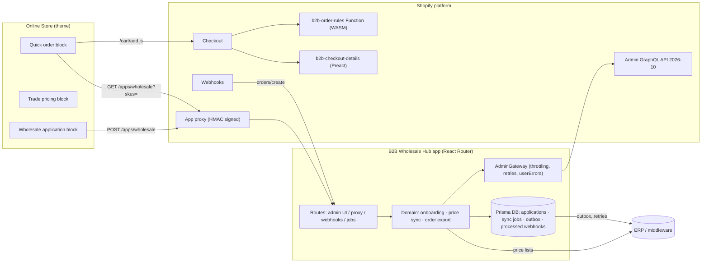

# Shopify B2B Wholesale Platform

A Shopify B2B wholesale platform for a (fictional) multi-brand outdoor equipment company: a custom Shopify app, a Shopify Function, a checkout UI extension and a theme app extension, integrated with an ERP.

It covers the full lifecycle of a trade account. A retailer (outdoor store, sporting goods chain, online shop) applies from the storefront and the sales team approves it. The retailer then orders under negotiated conditions (authorized brands, case packs, volume pricing, payment terms), and the order flows back to the ERP.

> **Stack**: Shopify Admin GraphQL API `2026-10` · React Router 7 · Polaris web components · Prisma · Shopify Functions (JS → WASM) · Checkout UI extensions (Preact) · Theme app extensions (Liquid) · Vitest · GitHub Actions

---

## Features

| Area | What it does | Where |
| --- | --- | --- |
| **Trade onboarding** | Storefront application form → review in the admin → one click creates the **Company**, main **contact**, **location**, ordering role, **catalog** assignment, **payment terms** (Net 30/60) and B2B rules | [`company-onboarding.ts`](app/lib/b2b/company-onboarding.ts), [`app.applications.$id.tsx`](app/routes/app.applications.$id.tsx) |
| **ERP price sync** | Publishes an ERP price list to a Shopify **B2B price list**: fixed prices, MSRP as compare-at, **quantity rules** (case packs) and **volume price breaks**, validated, batched and idempotent | [`price-sync.ts`](app/lib/b2b/price-sync.ts), [`price-list-mapping.ts`](app/lib/b2b/price-list-mapping.ts) |
| **Order export** | `orders/create` webhook → B2B orders mapped to the canonical ERP format (PO number, delivery date, cost center) → **transactional outbox** → delivered with exponential backoff and a dead-letter queue | [`order-export.ts`](app/lib/b2b/order-export.ts), [`webhooks.orders.create.tsx`](app/routes/webhooks.orders.create.tsx) |
| **Checkout rules** (Shopify Function) | Server-side B2B validation on every channel: **brand authorization** (distribution agreement per company), **case packs**, **minimum order value** per location (multi-currency), with EN/FR messages | [`extensions/b2b-order-rules`](extensions/b2b-order-rules) |
| **Checkout UI extension** | B2B-only block that collects a requested delivery date and a cost center, which are exported to the ERP | [`extensions/b2b-checkout-details`](extensions/b2b-checkout-details) |
| **Storefront** (theme app extension) | **Quick order** by SKU and spreadsheet paste, **trade pricing** table on the PDP (tiers, MSRP, case pack), **wholesale application** form, "ordering for <company>" **context bar** | [`extensions/b2b-storefront`](extensions/b2b-storefront) |
| **Store setup** | Idempotent creation of metafield definitions, a demo catalog and a wholesale catalog and price list | [`store-setup.ts`](app/lib/b2b/store-setup.ts) |
| **Compliance** | GDPR webhooks, HMAC-verified webhooks and app proxy, honeypot, no account enumeration, timing-safe secret comparison | [`webhooks.compliance.tsx`](app/routes/webhooks.compliance.tsx), [`apps.wholesale.tsx`](app/routes/apps.wholesale.tsx) |

## Architecture



The domain layer ([`app/lib`](app/lib)) has no dependency on React Router or Prisma. Its services receive an `AdminGateway` and an `ErpClient` port, so the business logic is unit-tested with plain fakes. The ERP sits behind an adapter ([`ErpClient`](app/lib/erp/types.ts)): a fixture-based mock for development and a REST adapter (timeouts, retries, `Retry-After`, `Idempotency-Key`) for production.

More detail lives in [`docs/ARCHITECTURE.md`](docs/ARCHITECTURE.md) and the [architecture decision records](docs/adr).

### B2B data contract

| Metafield | Owner | Type | Used by |
| --- | --- | --- | --- |
| `b2b.case_pack` | Product | `number_integer` | Function (validation), theme |
| `b2b.authorized_brands` | Company | `list.single_line_text_field` | Function (brand authorization) |
| `b2b.minimum_order_amount` | Company location | `number_decimal` | Function (minimum order) |

The single source of truth is [`app/lib/b2b/metafields.ts`](app/lib/b2b/metafields.ts).

## Getting started

Prerequisites:

- Node 22+
- A [Shopify Partner](https://partners.shopify.com) account
- A development store **with Shopify Plus features**, because B2B (companies, catalogs, price lists, payment terms) requires Plus

```bash
npm install
npm run dev            # logs in, links the app, opens a tunnel and installs it on the dev store
```

Then, in the app:

1. **Dashboard → Store setup**: create the metafield definitions, seed the demo catalog and create the wholesale catalog.
2. **ERP price sync**: publish `EU-WHOLESALE-EUR` to the wholesale price list. The report flags one unknown SKU and one invalid record on purpose.
3. **Online Store → Customize**:
   - Add the *Wholesale application* block to a page.
   - Add the *B2B quick order* block to another page.
   - Add *B2B trade pricing* to the product template.
   - Enable the *B2B context bar* app embed.
4. **Checkout editor**: add the *B2B checkout details* block, then activate the *B2B order rules* validation in **Settings → Checkout**.
5. Submit an application on the storefront, approve it in **Trade applications**, log in as the new contact and place an order.

## Quality

```bash
npm run check          # lint + types + GraphQL schema validation + app tests + Function tests
npm run theme:check    # Theme Check on the theme app extension
```

| Suite | Scope |
| --- | --- |
| `npm test` | Domain services: mapping and validation, throttling and retry, onboarding saga (incl. resume), outbox backoff and dead letter, form validation |
| `npm run test:functions` | Function unit tests plus **WASM integration tests**: fixtures are validated against the Function schema and run in Shopify's function runner |
| `npm run graphql:validate` | Every `#graphql` document in `app/` is validated against the pinned Admin API schema |

CI runs all of the above on every pull request ([`.github/workflows/ci.yml`](.github/workflows/ci.yml)). A scheduled workflow triggers outbox delivery ([`outbox-cron.yml`](.github/workflows/outbox-cron.yml)).

## Project structure

```
app/
  lib/
    core/          retry with jitter, collections
    shopify/       AdminGateway, SKU → variant resolution
    erp/           ErpClient port, HTTP adapter, mock adapter + fixtures
    b2b/           onboarding, price sync, order export/outbox, setup, data contract
  routes/          admin UI, app proxy, webhooks, cron endpoint
extensions/
  b2b-order-rules/        Shopify Function (cart & checkout validation)
  b2b-checkout-details/   Checkout UI extension (Preact)
  b2b-storefront/         Theme app extension (Liquid, vanilla JS web component)
docs/              architecture and ADRs
scripts/           GraphQL schema validation
test/              app unit tests
```

## License

MIT. Based on Shopify's [React Router app template](https://github.com/Shopify/shopify-app-template-react-router).
