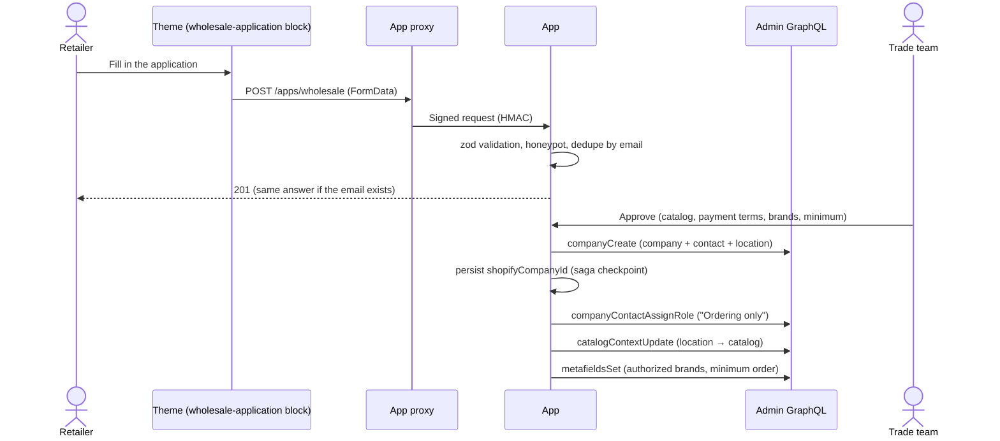
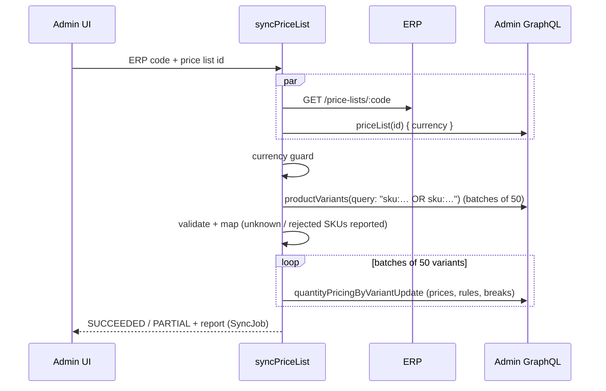
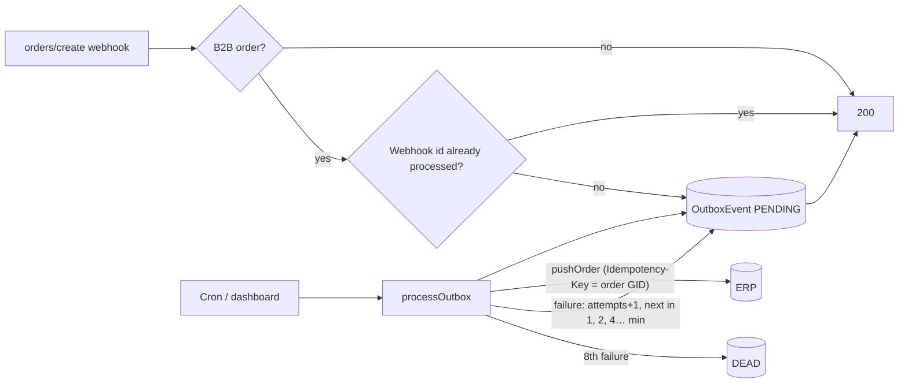

# Architecture

## Principles

1. **Shopify is the system of engagement, the ERP is the system of record** for prices, customers' credit and orders. Shopify-native B2B primitives are used wherever they exist (companies, catalogs, price lists, quantity rules, payment terms), and custom code only fills the gaps.
2. **Rules run where they can't be bypassed.** Business rules that protect revenue or the brand (brand authorization, case packs, minimum order value) run in a Shopify Function, so they apply on the Online Store, a headless storefront and the Storefront API alike. Theme code only improves the UX.
3. **Integrations tolerate failure.** Every call to an external system is idempotent, retried with backoff and observable from the admin.
4. **The domain is framework-free.** `app/lib` doesn't import React Router or Prisma, which keeps it testable and portable (for example to a queue worker).

## Flows

### 1. Trade account onboarding

Each step after `companyCreate` is idempotent. If a step fails, approving again resumes from the checkpoint instead of creating a duplicate company ([ADR 0003](adr/0003-resumable-onboarding-saga.md)).

### 2. ERP price list → Shopify B2B price list

* **Full replace per variant**: existing quantity rules and price breaks are deleted in the same mutation, so a re-run converges to the ERP state.
* **Validation before publication**: Shopify's constraints are checked locally (minimum multiple of increment, increasing tiers, decreasing prices…). A bad record is reported and doesn't fail the whole list.
* **MSRP** is published as the price list's compare-at price, so the theme can show "wholesale vs. retail" without extra data.

### 3. Order → ERP (transactional outbox)

The webhook handler only writes to the database and returns within Shopify's 5-second budget. Delivery is decoupled, at-least-once and idempotent end to end ([ADR 0002](adr/0002-transactional-outbox.md)).

## Shopify API usage

| Concern | Choice |
| --- | --- |
| API version | Pinned to `2026-10` in the app, webhooks and codegen. CI validates every document against that schema. |
| Rate limits | `AdminGateway` reads `extensions.cost.throttleStatus` and waits exactly as long as the bucket needs to refill before retrying `THROTTLED` responses. |
| Errors | Top-level GraphQL errors throw `ShopifyGraphqlError` (not retried). `userErrors` throw `ShopifyUserError` with field paths. 5xx responses are retried with full-jitter backoff. |
| Bulk volumes | The sync batches 50 variants per mutation. For catalogs above roughly 10k SKUs, the next step is `bulkOperationRunMutation` with a JSONL upload; the mapping layer already produces per-variant inputs. |

## Security

* Admin routes: `authenticate.admin` (session token, embedded app).
* App proxy: `authenticate.public.appProxy` verifies Shopify's HMAC signature. Quick order is restricted to logged-in customers (`logged_in_customer_id`) and never returns prices.
* Webhooks: `authenticate.webhook` (HMAC), deduplicated with `X-Shopify-Webhook-Id`.
* Cron endpoint: bearer secret compared with `timingSafeEqual`.
* Personal data: stored only in `WholesaleApplication`, and deleted on `customers/redact` and `shop/redact`.

## Going to production

* Database: switch the Prisma datasource to PostgreSQL. The schema is portable, and the string statuses can become enums.
* Hosting: the Dockerfile runs on Fly.io, Render, Cloud Run, etc. Set `ERP_MODE=http`, `ERP_BASE_URL`, `ERP_API_KEY` and `JOBS_SECRET`.
* Observability: the `SyncJob` and `OutboxEvent` tables already give an audit trail. Ship logs to the group's platform (Datadog, ELK…) and alert on `DEAD` events.
